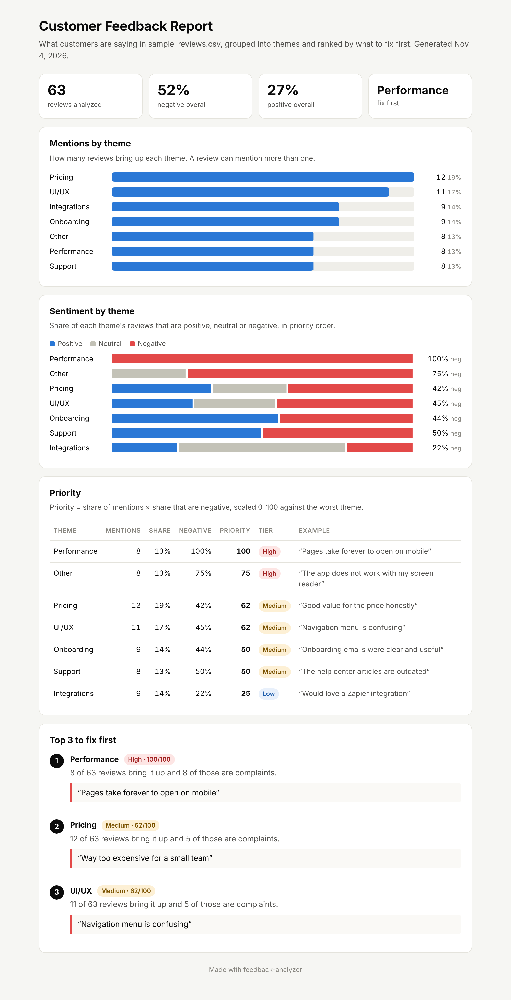

# Feedback Analyzer

**Turn hundreds of customer reviews into a ranked list of what to fix first.**



*A report generated from the sample data. Open the live version: [docs/sample_report.html](docs/sample_report.html)*

## The problem

Product teams collect feedback from app store reviews, G2, support tickets and NPS surveys, but it usually sits in a spreadsheet nobody reads.

- Feedback is scattered across sources and written in free text
- Reading every review by hand does not scale past a few dozen
- Without structure, roadmap decisions follow the loudest customer instead of the most common pain

## What it does

- **Groups reviews into themes**: Performance, Pricing, Onboarding, Integrations, Support, UI/UX (an editable keyword list)
- **Scores sentiment** for every review as positive, negative or neutral, and understands simple negation like "not good"
- **Ranks themes by priority** from 0 to 100 with a High / Medium / Low tier
- **Names the top 3 to fix first**, each backed by a real customer quote
- **Writes a one-page visual report** (`--html`) you can share in Slack or email
- **AI mode** (`--ai`, optional) uses Claude to find themes the keyword list misses

```
Analyzed 63 reviews
Sentiment: 27% positive, 52% negative, 21% neutral

Theme          Mentions   Share  Negative  Priority  Tier
-------------------------------------------------------------
Performance           8     13%      100%       100  High
Other                 8     13%       75%        75  High
Pricing              12     19%       42%        62  Medium
UI/UX                11     17%       45%        62  Medium
...

Top 3 to fix first
1. Performance (High, 100/100): 8 of 63 reviews bring it up and 8 of those are complaints.
   Customer quote: "Pages take forever to open on mobile"
```

## How to run

Requires Python 3.9+. No extra packages needed.

```bash
git clone https://github.com/aryamanjain43/feedback-analyzer.git
cd feedback-analyzer
python analyze.py                       # sample data
python analyze.py path/to/your.csv      # your own reviews (any CSV with a "text" column)
python analyze.py --html                # also writes output/report.html
python -m unittest                      # run the tests
```

## How prioritization works

A theme deserves attention when many people mention it **and** most of them are unhappy about it:

```
priority = (share of reviews that mention the theme) x (share of those mentions that are negative)
```

Scores are scaled 0 to 100 against the worst theme, so the top problem always scores 100. Ties go to the theme mentioned more often.

| Tier   | Score     | What it means     |
|--------|-----------|-------------------|
| High   | 70 to 100 | Fix now           |
| Medium | 40 to 69  | Plan for it       |
| Low    | 0 to 39   | Keep an eye on it |

In the sample data, Performance shows up in only 13% of reviews, but every one of them is a complaint. So it outranks Pricing, which is mentioned more often but is negative less than half the time.

## AI mode

The keyword list only knows the themes someone wrote down. Everything else lands in "Other", which ranks second in the sample data (reviews about screen readers, contrast and personal data). AI mode sends those reviews to Claude, asks it to propose new themes, and merges them into the normal report, marked `AI`.

It is optional. Without `--ai` the tool needs no installs.

```bash
pip install -r requirements-ai.txt
export ANTHROPIC_API_KEY=your-key-here   # never commit a key
python analyze.py --ai --html            # only "Other" reviews go to the API
python analyze.py --ai-all               # send every review to catch extra themes
```

If the SDK or key is missing, the tool says so and falls back to keyword themes.

## Roadmap

- [x] Theme tagging with an editable keyword list
- [x] Sentiment scoring per review
- [x] Priority score and tier per theme
- [x] Visual HTML report with charts
- [x] AI mode for discovering new themes
- [ ] Track themes over time to spot rising issues after a release
- [ ] Break results down by source (App Store vs. G2 vs. support tickets)
- [ ] Import directly from tools like Zendesk or the App Store

## Why I built this

I'm a Master of Engineering Management student at Duke focused on product management. Good prioritization starts with understanding customers, and this is a small, practical version of the feedback pipeline I'd want on any product team. It pairs with my [feature-prioritizer](https://github.com/aryamanjain43/feature-prioritizer) and [market-sizer](https://github.com/aryamanjain43/market-sizer) projects.

## Project structure

```
feedback-analyzer/
├── analyze.py              # entry point
├── src/themes.py           # theme keywords and tagging
├── src/sentiment.py        # sentiment scoring
├── src/priority.py         # priority score and tier
├── src/report.py           # HTML report with charts
├── src/ai_themes.py        # optional AI mode
├── tests/                  # unit tests
├── docs/                   # sample report and screenshot
└── data/sample_reviews.csv # 63 sample reviews from 4 sources
```

## License

[MIT](LICENSE)
